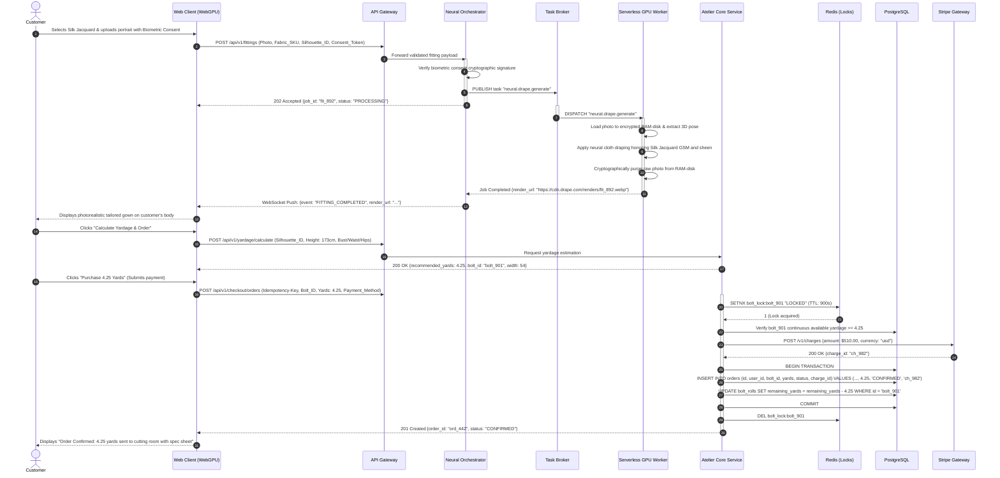

# System Architecture

## Architecture Overview

**Interfaces:** Web
**Architecture Style:** Hybrid Client-Accelerated WebGPU + Headless Event-Driven Core + Serverless GPU Worker Pool
**Primary Client:** Browser (SPA with SSR + Hydration, WebGPU/WebGL 2.0 cloth physics runtime)
**Hosting Model:** Cloud (Global Edge CDN, Managed Container Cluster, Serverless GPU Compute Pool, and Managed Relational Database)

Drape employs an event-driven, decoupled architecture designed to deliver 60 FPS real-time tactile cloth simulation directly in the browser while offloading intensive generative neural garment fitting and 360° motion video rendering to an elastic serverless GPU cluster. Core business transactions—including fractional yardage cutting calculations, inventory bolt reservations, and master tailor dispatch—are governed by an authoritative relational core ensuring strict financial and inventory integrity.

## System Components

### Component: Client Application
**Responsibility:** Delivers the responsive user interface, executes client-side WebGPU cloth physics simulations, renders the Micro-Weave inspector, and synthesizes dynamic haptic spatial audio.
**Provides:** Interactive 3D cloth manipulation ([FEAT-002](features/FEAT-002.md)), microscopic weave inspection with directional light shaders ([FEAT-003](features/FEAT-003.md)), real-time yardage calculation UI ([FEAT-007](features/FEAT-007.md)), and reactive Web Audio feedback ([FEAT-011](features/FEAT-011.md)).
**Consumes:** API Gateway (for catalog metadata and order placement), Neural Fitting Orchestrator (for fitting generation requests), and Edge CDN (for PBR textile textures).
**Platform Notes:** Optimized for modern desktop and mobile browsers supporting WebGPU, with automatic shader degradation to WebGL 2.0 and pre-recorded video loops for older hardware.

### Component: API Gateway / Reverse Proxy
**Responsibility:** Single secure entry point for all client requests; handles TLS 1.3 termination, rate limiting, CORS, and request authentication.
**Provides:** Unified REST and WebSocket endpoints, route dispatching, and DDoS mitigation.
**Consumes:** Auth & Session Service, Atelier Core Service, and Neural Fitting Orchestrator.
**Platform Notes:** Deployed across global edge nodes with automatic Web Application Firewall (WAF) rule evaluation.

### Component: Auth & Session Service
**Responsibility:** Manages customer authentication, biometric consent verification, and session lifecycle.
**Provides:** Session token validation, role-based access control (Customers, Cutters, Master Tailors, Administrators), and biometric consent audit trails ([FEAT-005](features/FEAT-005.md)).
**Consumes:** Primary Relational Database and In-Memory Cache.

### Component: Atelier Core Business Service
**Responsibility:** Governs the fabric catalog, manages physical bolt rolls, maintains continuous-yardage inventory locks, and coordinates order checkout ([FEAT-008](features/FEAT-008.md)).
**Provides:** Fabric search and filtering ([FEAT-001](features/FEAT-001.md)), inventory availability queries, price calculations for fractional yardage, and order lifecycle management.
**Consumes:** Primary Relational Database, In-Memory Cache, and Message Broker.

### Component: Yardage & Pattern Spec Engine
**Responsibility:** Executes deterministic tailoring cutting layout calculations based on customer dimensions, garment silhouettes, and bolt widths ([FEAT-007](features/FEAT-007.md)).
**Provides:** Exact yardage estimations, grainline alignment data, cutting diagrams, and PDF specification export generation ([FEAT-009](features/FEAT-009.md)).
**Consumes:** Atelier Core Service.

### Component: Neural Fitting Orchestrator
**Responsibility:** Mediates the generative AI fitting pipeline; enforces biometric privacy gates, manages asynchronous inference task queues, and handles ephemeral result caching.
**Provides:** Fitting job submission endpoints, WebSocket generation progress updates, and automatic fallback trigger handling ([NFR-011](nfr.md)).
**Consumes:** Auth Service (biometric consent verification), Serverless GPU Worker Pool (task execution), and In-Memory Cache.

### Component: Serverless GPU Worker Pool
**Responsibility:** Executes 3D body pose estimation, neural garment draping ([FEAT-004](features/FEAT-004.md)), and 360° motion video synthesis ([FEAT-006](features/FEAT-006.md)).
**Provides:** High-resolution photorealistic fitting renders and looping motion MP4 files.
**Consumes:** Message Broker task queue and Ephemeral Encrypted RAM-Disk.
**Platform Notes:** Autoscales from zero based on pending inference queue depth, executing within isolated, encrypted memory containers.

### Component: Cutting Room & Tailor Portal
**Responsibility:** Operational interface for cutting room specialists (Elena) to manage precision cutting queues and for certified partner tailors ([FEAT-010](features/FEAT-010.md)) to access client specs.
**Provides:** Cut queue management, barcode/QR scanner integration for bolt tracking, and digital tailor dossier views.
**Consumes:** Atelier Core Service and Object Storage.

### Component: Evaluation & Telemetry Service
**Responsibility:** Continuously evaluates model outputs against the golden benchmark quality bar ([NFR-030](nfr.md)), monitors inference latency ([NFR-004](nfr.md)), and logs system SLIs.
**Provides:** Quality assurance score dashboards and automated alerting on degradation.
**Consumes:** Neural Fitting Orchestrator.

## Data Architecture

### Data Stores
| Store | Type | What It Holds | Access Pattern |
|---|---|---|---|
| Primary Database | Relational (PostgreSQL) | User accounts, fabric SKUs, physical bolt records, fractional yardage orders, tailor specs | ACID transactions, read-heavy catalog, transactional order writes |
| In-Memory Cache | In-Memory (Redis) | User sessions, 15-minute inventory reservation locks, rate-limit buckets | Sub-millisecond reads/writes, TTL expiry |
| Object Storage | Cloud Object Store (S3-compatible) | Public PBR material maps, normal/roughness textures, editorial photography, exported PDF spec cards | Write-once, read-many via global Edge CDN |
| Ephemeral Memory | Encrypted RAM-Disk | Uploaded customer fitting photos and intermediate segmentation masks | Ephemeral write-once, hard-deleted within 15 minutes ([NFR-040](nfr.md)) |
| Search & Filter Index | Full-Text Search Engine | Fabric search indices, faceted composition and GSM filters | Read-only search queries, updated on catalog changes |

### Data Flow Patterns
- **Synchronous WebGPU Simulation:** Cloth physics calculations execute 100% locally on client GPU hardware using compiled WGSL shaders; zero network round-trip during tactile manipulation.
- **Asynchronous Generative Inference:** Customer photo uploads and style prompts post to the API Gateway &rarr; Orchestrator verifies biometric consent token &rarr; pushes job to GPU worker queue &rarr; client listens via WebSocket &rarr; worker renders composite to temporary storage &rarr; pushes result to client &rarr; deletes raw photo.
- **Transactional Inventory Hold:** Adding fractional yardage to checkout acquires a distributed Redis lock on the specific warehouse bolt ID with a 15-minute TTL, preventing dual-allocation of continuous yardage.

## External Integrations

| Service | Purpose | Direction | Criticality |
|---|---|---|---|
| Stripe | Payment processing for fractional yardage and sample swatches (PCI-DSS SAQ-A) | Outbound (API calls) | High |
| Serverless GPU Provider (Modal / RunPod) | Elastic GPU infrastructure for neural cloth draping and video synthesis | Outbound (Inference tasks) | High |
| Resend | Transactional notifications, order receipts, and digital tailor dossiers | Outbound (API calls) | High |
| DHL Express / FedEx Carrier APIs | Automated shipping label creation, pickup scheduling, and bolt tracking | Outbound (API calls) | High |
| Datadog | Real-time APM, error tracking, uptime monitoring, and latency alerting | Outbound (Telemetry stream) | Medium |
| Apple Quick Look / Android Scene Viewer | Native OS WebAR runtimes for 3D swatch projection ([FEAT-013](features/FEAT-013.md)) | Client-side launch | Low |

## Deployment Topology

### Environments
| Environment | Purpose | Data |
|---|---|---|
| Development | Feature development, shader testing, unit benchmarks | Synthetic fabric SKUs, mock GPU workers |
| Staging | Full end-to-end integration, performance profiling, golden-set ML testing | Anonymized production-like data, live testnet payments |
| Production | Live commercial traffic and white-glove cutting room operations | Real customer data, live inventory, encrypted biometric pipelines |

### Regions
- **Edge Layer:** Globally distributed CDN edge points of presence across North America, Europe, Asia, and Africa for sub-50ms static asset delivery.
- **Core Application & Database:** Primary deployment in `us-east-1` (Northern Virginia) with a read-replica and warm standby in `eu-west-1` (Dublin) to serve European atelier traffic with low latency.
- **GPU Inference Cluster:** Multi-region serverless GPU pool with auto-routing to the nearest available GPU node (US-East, US-West, EU-Central).

### Scaling Strategy
- **API and Core Services:** Horizontally auto-scaled container pods based on CPU/memory utilization (>70% threshold).
- **Serverless GPU Workers:** Event-driven dynamic scaling; worker nodes spin up within 800ms when pending inference jobs exceed 5 in the queue, scaling to zero during idle periods to manage operational costs.

## Cross-Cutting Concerns

**Authentication & Authorization:** Implements OWASP ASVS Level 2 standards. Customer sessions use secure, HttpOnly, SameSite cookies with JWT verification. Administrative cutting room access requires mandatory WebAuthn/TOTP Multi-Factor Authentication ([NFR-020](nfr.md)).
**Biometric Privacy & Ephemeral Data Lifecycle:** Enforces the Illinois BIPA and GDPR Article 9 mandate ([NFR-040](nfr.md)). Raw uploaded photographs are never written to persistent disk; they reside in encrypted volatile RAM-disks on GPU nodes and are cryptographically scrubbed immediately upon inference completion (max 15-minute lifespan).
**Error Handling & Fallbacks:** If the serverless GPU cluster experiences outage or queue exhaustion, the orchestrator triggers a circuit breaker, routing the client to a client-side 3D parametric mannequin render in the chosen fabric ([NFR-011](nfr.md)).
**Logging & Auditability:** Centralized, structured JSON logging with all Personally Identifiable Information (PII) masked. An immutable, tamper-evident audit log tracks all administrative cutting orders and user data deletion events for 365 days ([NFR-028](nfr.md)).
**Model Versioning:** The Neural Tailor pipeline is pinned to specific verified model weights and calibrated physics shader matrices. Any model checkpoint upgrade must pass the 500-case Master Tailor Golden Benchmark ([NFR-030](nfr.md)) prior to production promotion.

## Architecture Diagrams

### System Topology

```mermaid
C4Container
    title Container Diagram - Drape Digital Atelier Architecture

    Person(customer, "Client / Designer", "Interacts with tactile cloth sandbox and Neural Tailor fittings.")
    Person(tailor, "Cutter / Master Tailor", "Manages cutting queues and inspects digital tailor dossiers.")

    System_Boundary(drape_platform, "Drape Platform Boundary") {
        Container(web_app, "Frontend Application", "Next.js / WebGPU / TypeScript", "Delivers responsive UI, client-side cloth physics, and Web Audio soundscape")
        Container(api_gateway, "API Gateway & Edge Router", "Cloudflare Workers / WAF", "TLS termination, rate limiting, and route dispatching")
        Container(core_service, "Atelier Core Service", "Go / Node.js Service", "Manages catalog, inventory bolt locks, and checkout")
        Container(spec_engine, "Yardage & Pattern Engine", "Python / Go Service", "Calculates cutting layouts and generates PDF dossiers")
        Container(ml_orchestrator, "Neural Fitting Orchestrator", "Python / FastAPI", "Enforces biometric consent and manages inference queues")
        Container(gpu_workers, "Serverless GPU Worker Pool", "CUDA / PyTorch / Docker", "Executes neural draping and 360-degree video generation")
        ContainerDb(database, "Primary Database", "PostgreSQL", "Stores orders, fractional yardage ledgers, and bolt metadata")
        ContainerDb(cache, "In-Memory Store", "Redis", "Caches sessions, idempotency keys, and 15-minute inventory locks")
        ContainerQueue(message_queue, "Task Broker", "RabbitMQ / SQS", "Buffers asynchronous neural fitting and video render jobs")
        ContainerDb(ephemeral_storage, "Ephemeral RAM-Disk", "Encrypted Volatile Memory", "Temporarily buffers user portraits for inference (max 15m)")
    }

    System_Ext(payment_gateway, "Stripe", "PCI-DSS Level 1 payment processing")
    System_Ext(shipping_carrier, "DHL / FedEx API", "Shipping label generation and tracking")
    System_Ext(cdn_storage, "Cloud Object Storage & CDN", "PBR textures and static media delivery")

    Rel(customer, web_app, "Interacts with fabrics and uploads photo", "HTTPS")
    Rel(tailor, web_app, "Accesses cutting queues and specs", "HTTPS")
    Rel(web_app, api_gateway, "Dispatches API requests and uploads", "HTTPS / WSS")
    Rel(web_app, cdn_storage, "Streams high-resolution textile textures", "HTTPS")

    Rel(api_gateway, core_service, "Proxies catalog and checkout requests", "Internal HTTP")
    Rel(api_gateway, ml_orchestrator, "Routes fitting and motion jobs", "Internal HTTP")

    Rel(core_service, database, "Reads/writes catalog and orders", "TCP / SQL")
    Rel(core_service, cache, "Acquires 15-minute bolt locks", "Redis Protocol")
    Rel(core_service, spec_engine, "Requests yardage and pattern layouts", "gRPC")
    Rel(core_service, payment_gateway, "Processes customer charges", "HTTPS")
    Rel(core_service, shipping_carrier, "Dispatches bolt shipments", "HTTPS")

    Rel(ml_orchestrator, message_queue, "Publishes fitting tasks", "AMQP")
    Rel(ml_orchestrator, cache, "Tracks job progress and biometric tokens", "Redis Protocol")
    Rel(message_queue, gpu_workers, "Dispatches inference tasks", "AMQP")
    Rel(gpu_workers, ephemeral_storage, "Reads user photo; cryptographically purges after render", "Memory I/O")
    Rel(gpu_workers, cdn_storage, "Saves generated composite render", "HTTPS")
```

### Primary Transaction Flow: Neural Fitting to Custom Yardage Checkout

