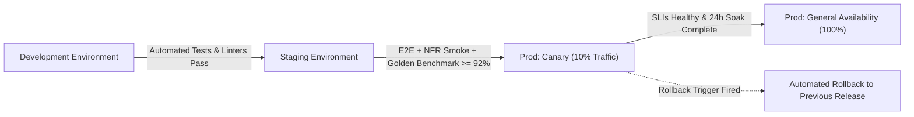

# Release & Rollout Strategy

This document defines how updates and new capabilities are delivered safely to [Drape](overview.md) users, how risks are mitigated through gated promotion and feature flagging, and how changes are reversed in the event of an anomaly.

---

## Overview

**Release cadence:** Continuous deployment for web front-end and Edge API routes; bi-weekly scheduled maintenance windows for Serverless GPU inference worker image updates; pinned checkpoint promotions for AI tailoring models.  
**Deployment model:** Canary-based gradual traffic shifting (10% &rarr; 50% &rarr; 100%) for web services; Blue-Green zero-downtime cutover for stateful database migrations and GPU inference microservices.  
**Release owner:** Atelier Platform Lead (supported by Release Engineering Lead).  
**Change approval:** Technical Lead and Product Director (with Master Tailor sign-off on AI model checkpoint promotions).

---

## Environments & Promotion

| Environment | Purpose | Data | Promotion Gate | Approver |
|---|---|---|---|---|
| **Development** | Feature branch testing, local shader development, and mock inference integration | Synthetic mock fabrics, simulated payment cards, ephemeral PostgreSQL database | Automated test suite passes (unit, component, and typechecking) with 100% clean linter run | PR Author & Peer Reviewer |
| **Staging** | Production-equivalent integration validation, browser matrix verification, GPU load testing | Anonymized production-like catalog (24 reference textiles), warm GPU serverless staging pool, sandbox payment webhooks | Full E2E test suite pass; [nfr](nfr.md) smoke benchmarks verified (LCP < 1.8s in [NFR-001](nfr.md), WebGPU &ge; 60 FPS in [NFR-003](nfr.md)); Master Tailor Golden Benchmark score &ge; 92% ([NFR-030](nfr.md)); OWASP dependency and secret scan clean | Release Engineering Lead |
| **Production** | Live atelier customer transactions, bespoke tailor order dispatches, cutting room execution | Real customer data, live Stripe payments, authoritative inventory balances | Canary bake period (24 hours at 10% traffic) with zero SEV-1/SEV-2 incidents; all Go-Live Checklist gates satisfied | Atelier Platform Lead & Product Director |

**Promotion rule:** Every change moves strictly through the environment pipeline one stage at a time (`Development` &rarr; `Staging` &rarr; `Production Canary` &rarr; `Production GA`). Never promote directly from Development to Production, and never promote an artifact or container image that differs from the one validated in Staging.

---

## Rollout Phases & Feature Flags

Rollout sequencing is directly aligned with the business phases specified in [roadmap](roadmap.md). Each phase undergoes internal soaking before external exposure.

### Rollout Phases

| Phase | Target Audience | Duration | Exit Criteria | Aligned Roadmap Phase |
|---|---|---|---|---|
| **Phase 1A: Internal Soak** | Internal engineering, QA, and resident master tailors | 2 weeks | Zero SEV-1 or SEV-2 defects; end-to-end fabric ordering and cutting room ticket flow ([user-flow](user-flow.md#flow-5-cutting-room-ticket--fulfillment-dispatch)) verified. | Phase 1: Core Atelier ([roadmap](roadmap.md#phase-1-core-atelier--the-sensory-drape--q1-2027)) |
| **Phase 1B: Atelier Beta** | 50 invited bespoke couture designers and bridal ateliers | 3 weeks | Minimum 150 completed sample swatches ordered; model fitting quality satisfaction &ge; 90%; payment and biometric consent compliance at 100%. | Phase 1: Core Atelier ([roadmap](roadmap.md#phase-1-core-atelier--the-sensory-drape--q1-2027)) |
| **Phase 1C: General Availability** | Public luxury fabric clientele and international patrons | Ongoing | All [nfr](nfr.md) performance thresholds sustained at 100% traffic; return rate below 3.0%. | Phase 1: Core Atelier ([roadmap](roadmap.md#phase-1-core-atelier--the-sensory-drape--q1-2027)) |
| **Phase 2A: Sensory Beta** | Opt-in Studio Pro tier subscribers ([monetization](monetization.md#pricing-tiers)) | 4 weeks | 360° motion video export P95 latency < 12.0s ([NFR-005](nfr.md)); tailor dispatch handoff success rate &ge; 98.0%. | Phase 2: Sensory Motion & Atelier Network ([roadmap](roadmap.md#phase-2-sensory-motion--atelier-network--q2-2027)) |
| **Phase 2B: Sensory GA** | All registered users and atelier partners | Ongoing | Platform-wide adoption of video turntable and tailor dispatch network with sustained SLIs. | Phase 2: Sensory Motion & Atelier Network ([roadmap](roadmap.md#phase-2-sensory-motion--atelier-network--q2-2027)) |
| **Phase 3: Connected Physicality** | Registered atelier partners and enterprise patrons | 6 weeks pilot &rarr; GA | NFC tap engagement &ge; 85% on shipped physical swatch books; custom generative dye orders manufactured with 0 dye-lot mismatch claims. | Phase 3: Connected Physicality & Global Expansion ([roadmap](roadmap.md#phase-3-connected-physicality--global-expansion--q3-2027)) |

### Feature Flag Matrix

Every dynamic capability is decoupled from deployment via feature flags, providing instant operational kill switches:

| Flag Name | Feature ID | Default State | Rollout Progression | Kill Switch Behavior |
|---|---|---|---|---|
| `ff_webgpu_cloth_physics` | [FEAT-002](features/FEAT-002.md) | Off | 0% &rarr; 10% &rarr; 50% &rarr; 100% | Disables real-time WebGPU compute pipeline; client seamlessly falls back to pre-rendered 60 FPS video loops and high-res canvas stills. |
| `ff_neural_tailor_fitting` | [FEAT-004](features/FEAT-004.md) | Off | Beta &rarr; 25% &rarr; 100% | Disables custom customer portrait upload and neural inference; client falls back to 8 pre-rendered parametric mannequin archetypes. |
| `ff_biometric_consent_gate` | [FEAT-005](features/FEAT-005.md) | On | 100% (Strict) | **Non-switchable in Production.** Bypassing or disabling this flag immediately halts all portrait upload endpoints. |
| `ff_360_motion_turntable` | [FEAT-006](features/FEAT-006.md) | Off | Studio Pro &rarr; 50% &rarr; 100% | Disables serverless video rendering; client hides the motion turntable tab and displays 8-axis static photography gallery. |
| `ff_concierge_tailor_dispatch` | [FEAT-010](features/FEAT-010.md) | Off | Curated Ateliers &rarr; 100% | Hides "Dispatch to Atelier" action at checkout; orders proceed as standard fabric shipment with downloadable client specification PDF ([FEAT-009](features/FEAT-009.md)). |
| `ff_haptic_sound_engine` | [FEAT-011](features/FEAT-011.md) | Off | 0% &rarr; 25% &rarr; 100% | Silences Web Audio synthesis engine; interface operates silently with zero impact on visual renderers or interaction flows. |
| `ff_generative_dye_lab` | [FEAT-012](features/FEAT-012.md) | Off | Phase 3 Pilot &rarr; 100% | Hides generative dye customization studio; catalog restricts selection to standard mill-dyed inventory. |
| `ff_nfc_ar_projection` | [FEAT-013](features/FEAT-013.md) | Off | Phase 3 Pilot &rarr; 100% | Disables WebXR AR camera overlay; NFC swatch scan routes directly to static swatch spec sheet URL. |

**Flag lifecycle:** When a feature flag reaches 100% general availability and maintains zero regressions through a full 30-day soak period, the flag is scheduled for deprecation and code removal in the subsequent release cycle.

---

## Rollback & Roll-forward

Rollback triggers are strictly automated or governed by measurable operational thresholds defined in [nfr](nfr.md) and [risk-log](risk-log.md). Rollbacks do not rely on subjective judgment.

### Measured Rollback Triggers

| Trigger Metric | Threshold & Window | Immediate Action | Decision Owner | Associated Risk / NFR |
|---|---|---|---|---|
| **GPU Tailor Inference Failure** | Error rate > 2.0% of generation requests for 5 consecutive minutes | Automated circuit breaker trips: traffic reverts to previous worker container image; if failure persists, flip `ff_neural_tailor_fitting` to Off | On-call Platform Engineer | [NFR-004](nfr.md), [R-001](risk-log.md) |
| **Tailor Fitting Latency** | P95 latency > 7.6s (2x of 3.8s baseline target in [NFR-004](nfr.md)) for > 10 minutes | Shed non-interactive video batch jobs; scale warm GPU pool; if unresolved, roll back inference release | On-call Platform Engineer | [NFR-004](nfr.md), [R-008](risk-log.md) |
| **WebGPU Client Crashes** | Device context lost or crash rate > 1.5% of active sessions over 10 minutes | Automatically toggle `ff_webgpu_cloth_physics` to Off for affected browser/OS cohort | On-call Platform Engineer | [NFR-003](nfr.md), [R-002](risk-log.md) |
| **Biometric Privacy Violation** | Any unencrypted portrait detected in persistent disk storage or lingering > 15 minutes | Halt portrait upload endpoint immediately; execute automated cryptographic RAM wipe; trigger [RB-05](operations.md#rb-05-biometric-ephemeral-purge-audit) audit | Platform Security Lead (No approval required) | [NFR-023](nfr.md), [NFR-040](nfr.md), [R-003](risk-log.md) |
| **Inventory Over-Allocation** | Concurrent order placement exceeds available continuous bolt length | Halt affected bolt roll checkout; roll back checkout API container to serial reservation mode; trigger [RB-02](operations.md#rb-02-physical-cutting-room-inventory-sync) | Atelier Platform Lead | [R-005](risk-log.md), [schema](schema.md#boltroll) |
| **Customer Support Ticket Spike** | Inbound cutting or rendering issue tickets > 3x hourly baseline within 1 hour | Disable the newly promoted feature flag; alert Release Owner for triage | Customer Care Lead &rarr; Release Owner | [operations](operations.md#support-slas--escalation-tiers) |

### Rollback Procedure

1. **Feature Flag Kill Switch:** For localized functional anomalies (e.g., sound engine distortion, WebGPU shader panic), the on-call engineer flips the corresponding flag in the edge configuration store. Time to propagate: < 30 seconds.
2. **Edge & Frontend Rollback:** If an anomaly resides in the client application or edge API routes, traffic is reverted to the preceding immutable container release via Cloudflare Edge deployment rollback. Time to recover: < 2 minutes.
3. **GPU Inference Container Rollback:** For worker regressions, serverless orchestration points back to the prior pinned container registry digest tag. Time to recover: < 3 minutes.
4. **Data Migrations & Backward Compatibility:**
   - Every database change must follow the Expand-and-Contract (Parallel Run) migration pattern.
   - New database columns and tables must be non-breaking, nullable, or carry defaults for at least one release cycle before older fields are deprecated.
   - Every migration script must be paired with an automated, tested down-migration (`rollback.sql`).
   - Any migration requiring destructive changes or table locks is classified as a "One-Way Door" and requires explicit sign-off from the Atelier Platform Lead and a scheduled maintenance window with pre-flight database snapshots.

---

## Go-Live Checklist

General Availability (GA) is gated strictly by this checklist. Every condition must be satisfied and verified against its source document before production launch.

- [ ] **P0 Feature Completeness:** All P0 functional requirements ([FEAT-001](features/FEAT-001.md) through [FEAT-005](features/FEAT-005.md), [FEAT-007](features/FEAT-007.md), [FEAT-008](features/FEAT-008.md)) pass 100% of functional acceptance criteria — verified in [features](features.md).
- [ ] **Performance Verification:** Core Web Vitals (LCP < 1.8s in [NFR-001](nfr.md)) and WebGPU frame rate (&ge; 60 FPS in [NFR-003](nfr.md) on designated GPUs) verified under synthetic load — verified in [nfr](nfr.md#performance--efficiency).
- [ ] **Neural Fitting Quality:** Master Tailor Golden Benchmark score achieves &ge; 92% across silk brocade, velvet, and sheer chiffon test sets — verified in [NFR-030](nfr.md) and [risk-log](risk-log.md#r-001-ai-garment-fitting-hallucination-or-unrealistic-drape).
- [ ] **Ephemeral Biometric Purge:** Automated cryptographic RAM-disk wipe verified; zero customer portrait artifacts retained beyond 15-minute lease — verified in [NFR-023](nfr.md), [NFR-040](nfr.md), and [operations](operations.md#rb-05-biometric-ephemeral-purge-audit).
- [ ] **Accessibility Compliance:** WCAG 2.2 Level AA accessibility audit completed with zero high-severity contrast, focus order, or screen reader violations — verified in [branding](branding.md#accessibility--contrast) and [NFR-001](nfr.md).
- [ ] **Analytics & Funnel Instrumentation:** All 15 telemetry events ([EVT-001](analytics.md#event-taxonomy) through [EVT-015](analytics.md#event-taxonomy)) emitting valid JSON payloads to the event warehouse — verified in [analytics](analytics.md).
- [ ] **Schema & Inventory Locking:** Database migrations applied cleanly with verified row-level locking for continuous bolt yardage allocations — verified in [schema](schema.md) and [user-flow](user-flow.md#flow-4-cut-yardage-checkout--swatch-sample-box).
- [ ] **Rollback Rehearsal:** Full rollback procedure (flag toggle, container revert, down-migration) rehearsed successfully in the Staging environment within a 5-minute recovery target.
- [ ] **Operational Runbooks Active:** All 6 operational runbooks ([RB-01](operations.md#rb-01-gpu-inference-pool-degradation) through [RB-06](operations.md#rb-06-cutting-hardware-scanner-failure)) reviewed and staffed with on-call personnel briefed — verified in [operations](operations.md).
- [ ] **Customer Care & Atelier Briefing:** Customer support teams and cutting room personnel trained on refund policies, non-returnable cut disclosures, and ticket queue handling — verified in [monetization](monetization.md#return--refund-policy) and [screens](screens/10-cutting-room-dashboard.md).
- [ ] **Public Status Page Configured:** Real-time system status page initialized with active synthetic monitoring checks on the payment gateway, WebGPU CDN assets, and GPU inference cluster.

---

## Communication

Transparent operational communication ensures client trust, partner alignment, and seamless change management.

- **Release notes:** Published to the public Atelier Changelog at `/changelog` upon every production release, detailing new textile additions, performance improvements, and interface updates. Major feature milestones (e.g., 360° motion generation, tailor network onboarding) are accompanied by an exclusive email bulletin to Couture Studio Pro subscribers.
- **Status page:** Hosted independently at `status.drapeatelier.com`. Automatically updated via webhook triggers during incident triage and resolution per the incident management protocol in [operations](operations.md#incident-management--post-mortems).
- **Stakeholder updates:** For scheduled maintenance windows or changes touching the cutting room fulfillment pipeline ([screens/10](screens/10-cutting-room-dashboard.md)), cutting facility managers and master tailor partners are notified via direct dashboard banner and automated SMS 48 hours prior to deployment.
- **Post-release review:** The engineering, product, and operations teams conduct a post-release review meeting within 48 hours of every major phase cutover. The review evaluates live conversion telemetry ([analytics](analytics.md#funnel-analysis)), infrastructure expenditure ([NFR-030](nfr.md)), and support ticket volume against established exit criteria.
