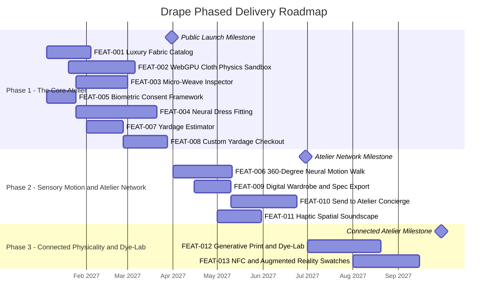

# Delivery Roadmap

## Vision Statement

To establish the world's preeminent digital fabric atelier where customers and bespoke fashion designers explore luxury textiles with lifelike physical motion, preview custom-draped garments tailored to their own bodies, and order precision-cut yardage with total confidence.

## Timeline Overview

## Phase 1: The Core Atelier (Launch Essentials)

**Goal:** Launch the core digital fabric showroom, interactive real-time cloth physics simulation, AI neural dress fitting, and custom fractional yardage checkout.
**Target:** Q1 2027 (March 2027)
**Key Outcomes:**
- Occasionwear clients and designers can browse, touch, and test the drape and fluidity of luxury textiles online.
- Customers can upload a personal photograph, select any fabric and dress silhouette, and preview the finished garment tailored to their body proportions.
- Buyers can calculate exact fabric yardage required and purchase swatches or precision-cut yardage with complete confidence.
- Establishes strict, transparent compliance with international biometric privacy standards.

**Features Delivered:**
| Feature ID | Feature | Why It Matters |
|---|---|---|
| [FEAT-001](features/FEAT-001.md) | Luxury Fabric Catalog & Multimodal Filtering | Allows customers to discover premium European and heritage textiles by composition, weight, and occasion. |
| [FEAT-002](features/FEAT-002.md) | WebGPU Real-Time Cloth Physics Sandbox | Enables shoppers to pull, wave, and fold virtual fabric to feel its stiffness and fluid movement before buying. |
| [FEAT-003](features/FEAT-003.md) | Micro-Weave Inspector with Dynamic Directional Lighting | Provides microscopic thread inspection and moving light reflections to reveal true sheen and metallic luster. |
| [FEAT-004](features/FEAT-004.md) | Multimodal Customer Neural Dress Fitting | Eliminates the anxiety of buying raw fabric by showing how the finished dress looks on the customer's body. |
| [FEAT-005](features/FEAT-005.md) | Biometric Consent & Ephemeral Image Lifecycle | Protects customer trust and complies with biometric privacy laws through automatic photo deletion. |
| [FEAT-007](features/FEAT-007.md) | Automated Yardage & Pattern Spec Estimator | Prevents costly fabric waste or project shortfalls by calculating exact yardage for the customer's dressmaker. |
| [FEAT-008](features/FEAT-008.md) | Luxury Swatch & Cut-to-Order Custom Yardage Checkout | Enables purchasing fractional cuts to an eighth of a yard or ordering curated sample presentation boxes. |

## Phase 2: Sensory Motion & Artisan Network

**Goal:** Transform the online fitting room into an immersive sensory environment with looping 360° motion video and direct master tailor fulfillment.
**Target:** Q2 2027 (June 2027)
**Key Outcomes:**
- Customers can see their custom-tailored dress in dynamic motion, watching how the hemline sways and catches light as they walk and turn.
- Shoppers can export a technical specification card or route their fabric and pattern specs directly to a vetted local master tailor.
- Subtle auditory cues (crisp tailoring shears, the gentle whisper of silk) recreate the sensory atmosphere of a private cutting salon.

**Features Delivered:**
| Feature ID | Feature | Why It Matters |
|---|---|---|
| [FEAT-006](features/FEAT-006.md) | 360° Looping Neural Motion & Garment Walk | Shows how flowing silks and structured wools move and ripple in real life as the wearer turns. |
| [FEAT-009](features/FEAT-009.md) | Digital Wardrobe & Tailor Handoff Spec Export | Produces an authoritative technical dossier that clients can hand directly to their personal dressmaker. |
| [FEAT-010](features/FEAT-010.md) | "Send to Atelier" Vetted Master Tailor Concierge | Offers end-to-end convenience by shipping fabric directly to certified partner tailors in major fashion capitals. |
| [FEAT-011](features/FEAT-011.md) | Haptic & Spatial Web Audio Soundscape | Deepens immersion through tactile sound design that evokes the physical craftsmanship of bespoke tailoring. |

## Phase 3: Connected Physicality & Generative Atelier

**Goal:** Bridge the physical and digital worlds through augmented reality sample boxes and on-demand custom generative textile printing.
**Target:** Q3 2027 (September 2027)
**Key Outcomes:**
- Designers and clients can customize pattern print scales and colorway palettes, ordering exclusive limited-run prints on pure silk and linen bases.
- Physical swatch boxes arrive with smart touch technology that projects life-size 3D dresses directly into the customer's dressing room.

**Features Delivered:**
| Feature ID | Feature | Why It Matters |
|---|---|---|
| [FEAT-012](features/FEAT-012.md) | Generative Dye-Lab & Pattern Scale Adjuster | Empowers couture designers to create one-of-a-kind prints and bespoke color palettes for private clients. |
| [FEAT-013](features/FEAT-013.md) | NFC & AR Physical Swatch Box Projection | Brings physical textile samples to life by projecting full-scale 3D garments onto physical mannequins and spaces. |

## What's Next

- **Automated Laser Cutting CAD Export:** Exporting verified pattern cut pieces directly to industrial digital cutting machines for bespoke tailoring ateliers.
- **Global Showroom Concierge Hubs:** Physical Drape sample lounges in London, Milan, New York, and Lagos featuring private fitting suites and interactive digital tables.
