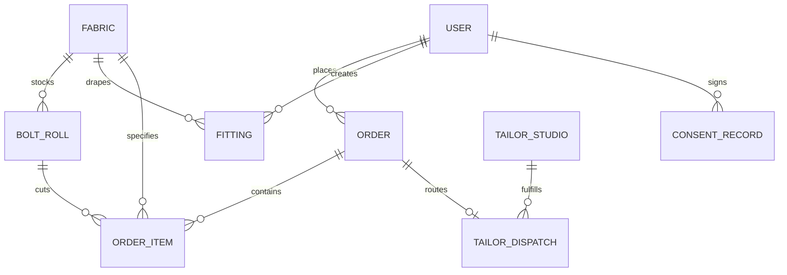

# Data Model

## Overview

The Drape data architecture is designed as a normalized, referential relational model targeting PostgreSQL for strict transactional integrity, combined with high-speed Redis caching for active bolt reservation locks. All physical textile cuts, inventory rolls, and financial transactions maintain explicit foreign-key relationships. Biometric consent logs and ephemeral customer fitting records are modeled with strict lifecycle expiration timestamps to enforce privacy compliance per [nfr](nfr.md).

## Entity Relationships



## Entities

### User
Represents customer patrons, boutique atelier designers, and operations staff. Personal data fields are marked for regulatory lifecycle governance.

```json
{
  "$schema": "https://json-schema.org/draft/2020-12/schema",
  "$id": "https://drape.com/schemas/user.schema.json",
  "title": "User",
  "description": "An authenticated customer, couture designer, or atelier operator.",
  "type": "object",
  "properties": {
    "id": { "type": "string", "description": "Unique stable identifier for the user (UUIDv4)." },
    "email": { "type": "string", "format": "email", "description": "User email address. (Personal Data - GDPR/CCPA)." },
    "fullName": { "type": "string", "description": "Customer full legal name. (Personal Data - GDPR/CCPA).", "maxLength": 100 },
    "phone": { "type": "string", "description": "Contact telephone number for courier delivery. (Personal Data - GDPR/CCPA)." },
    "role": { "type": "string", "enum": ["customer", "atelier_pro", "cutter", "tailor", "admin"], "description": "System authorization role." },
    "createdAt": { "type": "string", "format": "date-time", "description": "Account registration timestamp in UTC." }
  },
  "required": ["id", "email", "fullName", "role", "createdAt"]
}
```

### ConsentRecord
Stores immutable, cryptographically verifiable biometric consent logs in compliance with Illinois BIPA (740 ILCS 14/) and GDPR Article 9 ([FEAT-005](features/FEAT-005.md), [NFR-040](nfr.md)).

```json
{
  "$schema": "https://json-schema.org/draft/2020-12/schema",
  "$id": "https://drape.com/schemas/consent-record.schema.json",
  "title": "ConsentRecord",
  "description": "An immutable audit record of affirmative biometric consent for neural photo fitting.",
  "type": "object",
  "properties": {
    "id": { "type": "string", "description": "Unique identifier for the consent transaction (UUIDv4)." },
    "userId": { "type": "string", "description": "References the User who executed the consent." },
    "regulationStandard": { "type": "string", "enum": ["BIPA_IL", "GDPR_ART_9", "CCPA_CPRA", "CUBI_TX"], "description": "The specific regulatory framework satisfied." },
    "consentGranted": { "type": "boolean", "description": "Affirmative agreement boolean flag." },
    "ipAddress": { "type": "string", "description": "Client IP address at execution time. (Personal Data - masked for telemetry)." },
    "userAgent": { "type": "string", "description": "Client browser and device user-agent string." },
    "grantedAt": { "type": "string", "format": "date-time", "description": "UTC timestamp of consent acceptance." },
    "expiresAt": { "type": "string", "format": "date-time", "description": "Timestamp when consent signature expires (max 365 days)." }
  },
  "required": ["id", "userId", "regulationStandard", "consentGranted", "ipAddress", "grantedAt", "expiresAt"]
}
```

### Fabric
The central catalog entity defining physical textile composition, weight, weave structure, and rendering assets.

```json
{
  "$schema": "https://json-schema.org/draft/2020-12/schema",
  "$id": "https://drape.com/schemas/fabric.schema.json",
  "title": "Fabric",
  "description": "A luxury textile SKU available in the digital atelier.",
  "type": "object",
  "properties": {
    "id": { "type": "string", "description": "Unique textile SKU identifier (e.g., FAB-SLK-892)." },
    "name": { "type": "string", "description": "Commercial textile name (e.g., Emerald Architectural Silk Brocade).", "maxLength": 120 },
    "millName": { "type": "string", "description": "Originating textile mill or historic weaver." },
    "countryOfOrigin": { "type": "string", "description": "Country where the textile was woven (ISO 3166-1 alpha-2)." },
    "fiberBreakdown": { "type": "string", "description": "Certified fiber composition (e.g., 85% Mulberry Silk, 15% Metallic Lurex)." },
    "gsm": { "type": "number", "minimum": 30, "maximum": 900, "description": "Grams per square meter certified mass density." },
    "widthInches": { "type": "number", "minimum": 36, "maximum": 72, "description": "Usable bolt width in inches across the grain." },
    "drapeCoefficient": { "type": "number", "minimum": 0.0, "maximum": 1.0, "description": "Laboratory physical drape fluidity rating (0.0=rigid, 1.0=liquid fluid)." },
    "stiffnessRating": { "type": "number", "minimum": 0.0, "maximum": 10.0, "description": "Bending stiffness modulus rating." },
    "pricePerYard": { "type": "number", "minimum": 10.0, "description": "Base price per full linear yard in USD." },
    "pbrTexturesUrl": { "type": "string", "format": "uri", "description": "Secure CDN endpoint hosting PBR normal, roughness, and albedo maps." },
    "createdAt": { "type": "string", "format": "date-time", "description": "Record creation timestamp in UTC." }
  },
  "required": ["id", "name", "millName", "countryOfOrigin", "fiberBreakdown", "gsm", "widthInches", "drapeCoefficient", "stiffnessRating", "pricePerYard", "pbrTexturesUrl", "createdAt"]
}
```

### BoltRoll
Models individual physical bolts stored in the temperature-controlled cutting room, tracking continuous remaining yardage and dye-lot batch codes.

```json
{
  "$schema": "https://json-schema.org/draft/2020-12/schema",
  "$id": "https://drape.com/schemas/bolt-roll.schema.json",
  "title": "BoltRoll",
  "description": "An authoritative physical roll of fabric in warehouse inventory.",
  "type": "object",
  "properties": {
    "id": { "type": "string", "description": "Unique barcode identifier scanned on the physical bolt (e.g., bolt_901)." },
    "fabricId": { "type": "string", "description": "References the Fabric SKU of this roll." },
    "dyeLotCode": { "type": "string", "description": "Certified dye batch identifier from the mill (e.g., LOT-2026-EMR-04)." },
    "initialYards": { "type": "number", "minimum": 1.0, "description": "Original total continuous length when received from the mill." },
    "remainingContinuousYards": { "type": "number", "minimum": 0.0, "description": "Current unbroken continuous yardage available for custom cutting." },
    "status": { "type": "string", "enum": ["active", "quarantined", "depleted"], "description": "Operational roll state." },
    "warehouseLocation": { "type": "string", "description": "Physical rack and bin coordinate in the cutting room." },
    "createdAt": { "type": "string", "format": "date-time", "description": "Receipt timestamp in UTC." }
  },
  "required": ["id", "fabricId", "dyeLotCode", "initialYards", "remainingContinuousYards", "status", "warehouseLocation", "createdAt"]
}
```

### Fitting
Models an AI neural garment fitting session, including silhouette parameters, generated asset links, and privacy expiration timers.

```json
{
  "$schema": "https://json-schema.org/draft/2020-12/schema",
  "$id": "https://drape.com/schemas/fitting.schema.json",
  "title": "Fitting",
  "description": "A generative neural garment fitting session linking customer pose and textile physics.",
  "type": "object",
  "properties": {
    "id": { "type": "string", "description": "Unique fitting identifier (UUIDv4)." },
    "userId": { "type": "string", "description": "References the User owning the fitting session." },
    "fabricId": { "type": "string", "description": "References the Fabric SKU draped onto the garment." },
    "silhouetteId": { "type": "string", "description": "Garment silhouette preset ID or custom pattern block." },
    "renderUrl": { "type": "string", "format": "uri", "description": "CDN URL of the photorealistic composite fitting render." },
    "motionVideoUrl": { "type": "string", "format": "uri", "description": "CDN URL of the 4-second looping 360-degree video walk (nullable)." },
    "drapeScore": { "type": "number", "minimum": 0.0, "maximum": 1.0, "description": "Algorithmic drape fit confidence score." },
    "status": { "type": "string", "enum": ["queued", "processing", "completed", "failed"], "description": "Inference lifecycle state." },
    "ephemeralExpiresAt": { "type": "string", "format": "date-time", "description": "UTC timestamp when temporary portrait assets are purged (max 15m)." },
    "createdAt": { "type": "string", "format": "date-time", "description": "Session submission timestamp in UTC." }
  },
  "required": ["id", "userId", "fabricId", "silhouetteId", "status", "ephemeralExpiresAt", "createdAt"]
}
```

### Order
Represents a commercial transaction for custom-cut textiles, swatch boxes, or concierge tailoring handoffs.

```json
{
  "$schema": "https://json-schema.org/draft/2020-12/schema",
  "$id": "https://drape.com/schemas/order.schema.json",
  "title": "Order",
  "description": "A commercial purchase of custom-cut yardage or swatch presentation boxes.",
  "type": "object",
  "properties": {
    "id": { "type": "string", "description": "Unique order identifier (UUIDv4)." },
    "userId": { "type": "string", "description": "References the User who placed the order." },
    "orderNumber": { "type": "string", "description": "Human-readable order tracking number (e.g., DRP-2027-442)." },
    "totalAmount": { "type": "number", "minimum": 0.0, "description": "Total charged transaction amount." },
    "currency": { "type": "string", "enum": ["USD", "EUR", "GBP", "NGN"], "description": "Transaction currency code (ISO 4217)." },
    "status": { "type": "string", "enum": ["pending", "confirmed", "cutting", "dispatched", "delivered", "cancelled"], "description": "Fulfillment state." },
    "paymentChargeId": { "type": "string", "description": "Stripe charge or payment intent identifier." },
    "shippingAddress": {
      "type": "object",
      "description": "Physical shipping destination. (Personal Data - GDPR/CCPA).",
      "properties": {
        "street": { "type": "string", "description": "Street line address." },
        "city": { "type": "string", "description": "Destination city." },
        "postalCode": { "type": "string", "description": "Postal or ZIP code." },
        "country": { "type": "string", "description": "Destination country code (ISO 3166-1 alpha-2)." }
      },
      "required": ["street", "city", "postalCode", "country"]
    },
    "createdAt": { "type": "string", "format": "date-time", "description": "Order placement timestamp in UTC." }
  },
  "required": ["id", "userId", "orderNumber", "totalAmount", "currency", "status", "paymentChargeId", "shippingAddress", "createdAt"]
}
```

### OrderItem
Specifies individual cuts severed from active bolts or swatch presentation boxes.

```json
{
  "$schema": "https://json-schema.org/draft/2020-12/schema",
  "$id": "https://drape.com/schemas/order-item.schema.json",
  "title": "OrderItem",
  "description": "A specific fractional textile cut or sample item within an Order.",
  "type": "object",
  "properties": {
    "id": { "type": "string", "description": "Unique order line item identifier (UUIDv4)." },
    "orderId": { "type": "string", "description": "References the parent Order." },
    "fabricId": { "type": "string", "description": "References the ordered Fabric SKU." },
    "boltRollId": { "type": "string", "description": "References the specific physical BoltRoll cut by the cutting room." },
    "yardsCut": { "type": "number", "minimum": 0.125, "description": "Precise linear yardage severed from the bolt in 1/8th yard increments." },
    "unitPrice": { "type": "number", "minimum": 0.0, "description": "Price charged per yard at transaction time." },
    "isSwatchBox": { "type": "boolean", "description": "Flag indicating if item is a $25 sample swatch presentation box." },
    "createdAt": { "type": "string", "format": "date-time", "description": "Item creation timestamp in UTC." }
  },
  "required": ["id", "orderId", "fabricId", "boltRollId", "yardsCut", "unitPrice", "isSwatchBox", "createdAt"]
}
```

### TailorStudio
Directory profile of accredited bespoke master tailors and couture dressmakers participating in the concierge network ([FEAT-010](features/FEAT-010.md)).

```json
{
  "$schema": "https://json-schema.org/draft/2020-12/schema",
  "$id": "https://drape.com/schemas/tailor-studio.schema.json",
  "title": "TailorStudio",
  "description": "An accredited master tailor studio partner in the Drape concierge network.",
  "type": "object",
  "properties": {
    "id": { "type": "string", "description": "Unique studio identifier (UUIDv4)." },
    "studioName": { "type": "string", "description": "Commercial atelier name (e.g., Atelier Savile New York).", "maxLength": 100 },
    "masterCutter": { "type": "string", "description": "Name of the lead master cutter or directrice." },
    "city": { "type": "string", "description": "Metropolitan location (e.g., London, New York, Paris, Milan, Lagos)." },
    "address": { "type": "string", "description": "Physical studio delivery address for fabric rolls." },
    "rating": { "type": "number", "minimum": 1.0, "maximum": 5.0, "description": "Verified client satisfaction score." },
    "activeCapacity": { "type": "boolean", "description": "Availability flag indicating if atelier is accepting new client commissions." },
    "contactEmail": { "type": "string", "format": "email", "description": "Studio operational email address." },
    "createdAt": { "type": "string", "format": "date-time", "description": "Atelier onboarding timestamp in UTC." }
  },
  "required": ["id", "studioName", "masterCutter", "city", "address", "rating", "activeCapacity", "contactEmail", "createdAt"]
}
```

### TailorDispatch
Manages white-glove logistics routing fabric orders and digital technical dossiers to partner tailors.

```json
{
  "$schema": "https://json-schema.org/draft/2020-12/schema",
  "$id": "https://drape.com/schemas/tailor-dispatch.schema.json",
  "title": "TailorDispatch",
  "description": "A concierge dispatch connecting an Order with an accredited TailorStudio.",
  "type": "object",
  "properties": {
    "id": { "type": "string", "description": "Unique dispatch record identifier (UUIDv4)." },
    "orderId": { "type": "string", "description": "References the parent Order containing the cut fabric." },
    "tailorStudioId": { "type": "string", "description": "References the assigned TailorStudio partner." },
    "status": { "type": "string", "enum": ["dispatched", "received_at_atelier", "fitting_scheduled", "in_construction", "completed"], "description": "Atelier handoff status." },
    "digitalSpecUrl": { "type": "string", "format": "uri", "description": "Secure endpoint to the technical cutting layout and 3D preview dossier." },
    "carrierTrackingNumber": { "type": "string", "description": "DHL/FedEx tracking number for the physical bolt package." },
    "dispatchedAt": { "type": "string", "format": "date-time", "description": "Carrier dispatch timestamp in UTC." }
  },
  "required": ["id", "orderId", "tailorStudioId", "status", "digitalSpecUrl", "dispatchedAt"]
}
```
