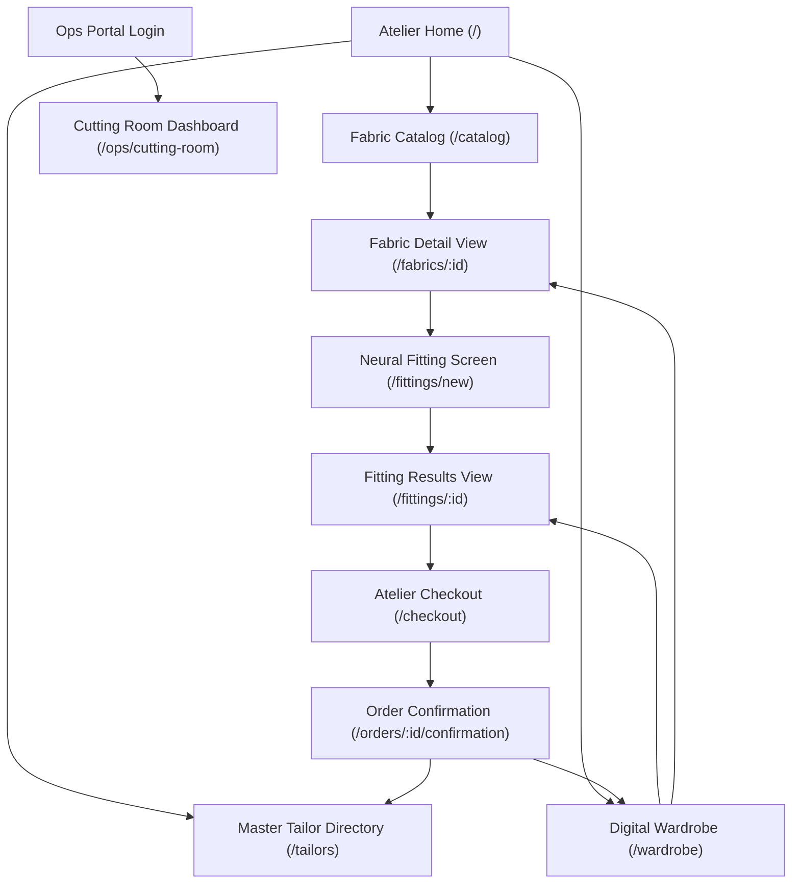

# Screen Definitions

## Screen Inventory

| # | Screen Name | File | Route / Path | Platform | Related Features |
|---|---|---|---|---|---|
| 1 | Atelier Home | [01-atelier-home](screens/01-atelier-home.md) | `/` | Web | [FEAT-001](features/FEAT-001.md) |
| 2 | Fabric Catalog | [02-fabric-catalog](screens/02-fabric-catalog.md) | `/catalog` | Web | [FEAT-001](features/FEAT-001.md) |
| 3 | Fabric Detail View | [03-fabric-detail-view](screens/03-fabric-detail-view.md) | `/fabrics/:id` | Web | [FEAT-001](features/FEAT-001.md), [FEAT-002](features/FEAT-002.md), [FEAT-003](features/FEAT-003.md), [FEAT-011](features/FEAT-011.md) |
| 4 | Neural Fitting Screen | [04-neural-fitting-screen](screens/04-neural-fitting-screen.md) | `/fittings/new` | Web | [FEAT-004](features/FEAT-004.md), [FEAT-005](features/FEAT-005.md) |
| 5 | Fitting Results View | [05-fitting-results-view](screens/05-fitting-results-view.md) | `/fittings/:id` | Web | [FEAT-004](features/FEAT-004.md), [FEAT-006](features/FEAT-006.md), [FEAT-007](features/FEAT-007.md) |
| 6 | Atelier Checkout | [06-atelier-checkout](screens/06-atelier-checkout.md) | `/checkout` | Web | [FEAT-007](features/FEAT-007.md), [FEAT-008](features/FEAT-008.md) |
| 7 | Order Confirmation | [07-order-confirmation](screens/07-order-confirmation.md) | `/orders/:id/confirmation` | Web | [FEAT-008](features/FEAT-008.md), [FEAT-009](features/FEAT-009.md) |
| 8 | Master Tailor Directory | [08-master-tailor-directory](screens/08-master-tailor-directory.md) | `/tailors` | Web | [FEAT-010](features/FEAT-010.md) |
| 9 | Digital Wardrobe | [09-digital-wardrobe](screens/09-digital-wardrobe.md) | `/wardrobe` | Web | [FEAT-004](features/FEAT-004.md), [FEAT-009](features/FEAT-009.md) |
| 10 | Cutting Room Dashboard | [10-cutting-room-dashboard](screens/10-cutting-room-dashboard.md) | `/ops/cutting-room` | Web | [FEAT-008](features/FEAT-008.md), [FEAT-009](features/FEAT-009.md) |

## Navigation Map

## Shared / Common Components

### Navigation Shell
Used on: all consumer web screens ([01](screens/01-atelier-home.md), [02](screens/02-fabric-catalog.md), [03](screens/03-fabric-detail-view.md), [04](screens/04-neural-fitting-screen.md), [05](screens/05-fitting-results-view.md), [06](screens/06-atelier-checkout.md), [07](screens/07-order-confirmation.md), [08](screens/08-master-tailor-directory.md), [09](screens/09-digital-wardrobe.md))
- Sticky luxury header with high-contrast Drape monogram/wordmark lockup, search trigger, audio ambience toggle ([FEAT-011](features/FEAT-011.md)), and wardrobe drawer access.
- Mobile: Collapsible bottom slide sheet for active fitting preview and cart count.

### Empty State
Used on: Fabric Catalog, Digital Wardrobe, Master Tailor Directory
- Centered sculptural graphic or illustration (200px)
- Headline: "No matching textiles found" / "Your wardrobe is empty"
- Editorial description: Contextual advice and suggested search tags
- Primary action button: "Reset Filters" or "Explore Current Curations"

### Error State
Used on: all data-fetching and WebGPU rendering screens
- Centered minimal graphic with warm ecru tone
- Title: "Atmospheric Interruption"
- Subtitle: Clear explanation of network, shader, or GPU cluster status
- Primary action: "Try Again"
- Secondary action: "Continue with Standard 3D Mannequin"

### Biometric Privacy Consent Modal
Used on: [Neural Fitting Screen](screens/04-neural-fitting-screen.md)
- Modal dialog with title: "Bespoke Fitting & Biometric Privacy Notice"
- Body: Plain-language summary of ephemeral RAM processing, 15-minute hard delete, and zero persistent facial vector storage per Illinois BIPA and GDPR Art. 9.
- Actions: "I Consent & Proceed" (Primary) and "Use Anonymous 3D Mannequin" (Secondary).

### Loading Skeleton
Used on: Fabric Catalog, Detail View, Wardrobe
- Shimmering warm ecru skeleton placeholder matching exact card and viewport dimensions.

## Shared Assets

| Asset | Direction | Where it appears | Style pointer |
|---|---|---|---|
| Atelier Hero Cascade | Heavy ivory silk and charcoal worsted wool cascading down architectural limestone blocks in gentle morning light. | [Atelier Home](screens/01-atelier-home.md) hero, full-width | Photography Direction |
| Empty Wardrobe Artwork | An antique wooden tailor valet stand holding a clean brass hanger in an airy, sunlit Parisian studio. | [Digital Wardrobe](screens/09-digital-wardrobe.md) empty state | Photography Direction |
| Biometric Shield Emblem | A fine 1.5px gold line-art shield enclosing a subtle woven textile lattice, symbolizing privacy protection. | Biometric Privacy Consent Modal header | Iconography Direction |
