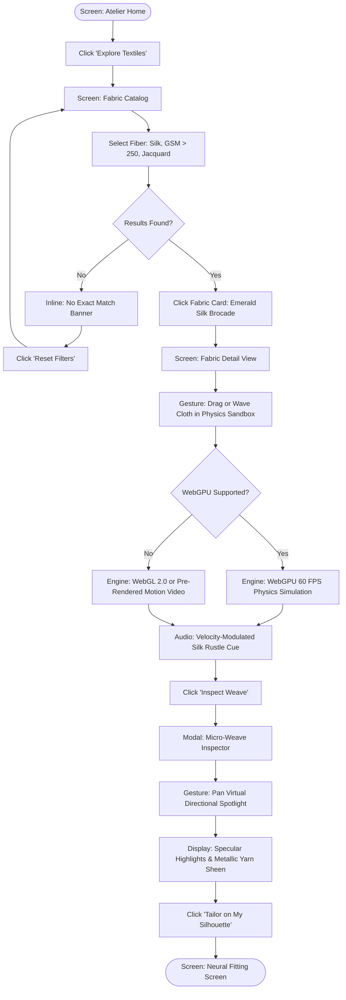
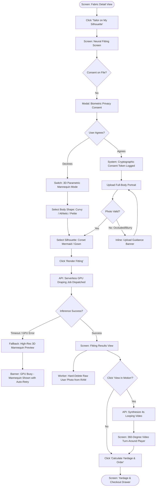
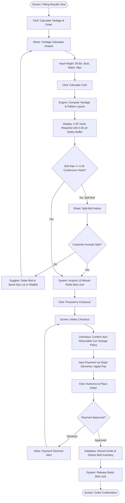
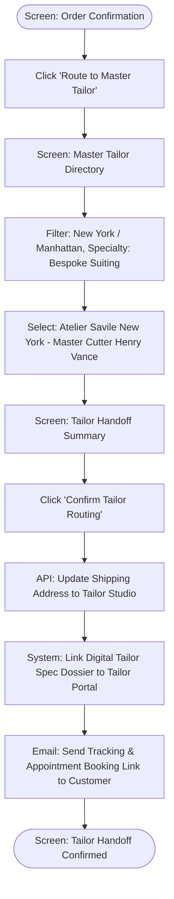
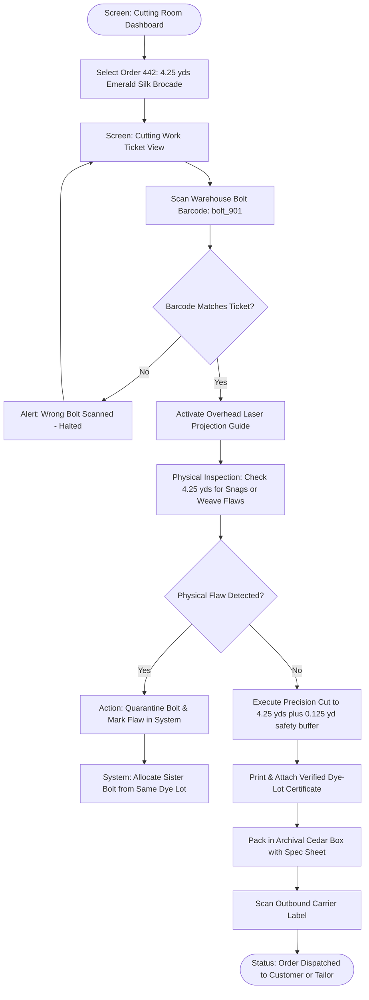

# User Journeys

## Flow Inventory

### Consumer Atelier Flows

| # | Flow Name | Persona | Entry Point | Outcome | Related Features |
|---|---|---|---|---|---|
| 1 | Textile Discovery & Tactile Physics Exploration | [Amara Okafor](user-personas.md) / [Julien Moreau](user-personas.md) | Atelier Home or Search Bar | Fabric weight, fluid drape, and microscopic weave evaluated | [FEAT-001](features/FEAT-001.md), [FEAT-002](features/FEAT-002.md), [FEAT-003](features/FEAT-003.md), [FEAT-011](features/FEAT-011.md) |
| 2 | Multimodal Neural Tailor Virtual Fitting | [Amara Okafor](user-personas.md) | Fabric Detail View | Custom garment rendered photorealistically on customer's body | [FEAT-004](features/FEAT-004.md), [FEAT-005](features/FEAT-005.md), [FEAT-006](features/FEAT-006.md) |
| 3 | Yardage Calculation & Custom Cut Checkout | [Amara Okafor](user-personas.md) | Neural Fitting Screen | Precision yardage calculated, continuous bolt locked, and order completed | [FEAT-007](features/FEAT-007.md), [FEAT-008](features/FEAT-008.md), [FEAT-009](features/FEAT-009.md) |
| 4 | "Send to Atelier" Master Tailor Handoff | [Marcus Sterling](user-personas.md) | Order Confirmation or Digital Wardrobe | Fabric dispatched to accredited partner tailor with digital spec dossier linked | [FEAT-009](features/FEAT-009.md), [FEAT-010](features/FEAT-010.md) |

### Internal Operations & Curation Flows

| # | Flow Name | Persona | Entry Point | Outcome | Related Features |
|---|---|---|---|---|---|
| 5 | Cutting Room Order Fulfillment & Bolt QA | [Elena Rostova](user-personas.md) | Cutting Room Dashboard | Physical bolt scanned, precision cut completed, and archival packaging dispatched | [FEAT-008](features/FEAT-008.md), [FEAT-009](features/FEAT-009.md) |

## Flow 1: Textile Discovery & Tactile Physics Exploration

**Persona:** [Amara Okafor](user-personas.md) / [Julien Moreau](user-personas.md)  
**Entry Point:** Screen: Atelier Home or Screen: Fabric Catalog  
**Outcome:** User discovers an ideal textile and evaluates its physical drape, weight, and microscopic weave structure under dynamic lighting.

### Diagram

### Walkthrough

**Happy Path:**
1. User lands on the Atelier Home, greeted by high-fashion editorial imagery and a curated collection rail.
2. User clicks "Explore Textiles" to open the Fabric Catalog screen.
3. User filters for "100% Mulberry Silk", "GSM > 250", and "Jacquard Weave".
4. Catalog displays filtered results meeting the criteria within 150ms.
5. User clicks on "Emerald Architectural Silk Brocade" to open the Fabric Detail View.
6. The interactive WebGPU cloth physics canvas loads with the brocade rendered in 3D.
7. System detects WebGPU hardware support and compiles the WGSL cloth simulation shaders.
8. User uses their mouse or finger to drag and wave the fabric; the cloth billows with authentic stiffness and inertia at 60 FPS.
9. Web Audio synthesizes a synchronized, subtle silk rustle audio cue matched to drag velocity.
10. User clicks "Inspect Weave", opening the Micro-Weave Inspector modal.
11. User pans the virtual spotlight from left to right, observing real-time specular highlights and gold metallic thread luster.
12. Confident in the material's physical qualities, user clicks "Tailor on My Silhouette", transitioning into the Neural Fitting Screen.

**Alternate Path A — No Matching Results:**
- At step 4, if the combination of filters yields zero matching SKUs: an inline message displays "No textiles currently match all selected filters." Suggestions appear recommending loosening the GSM range or exploring sister weaves. User clicks "Reset Filters" and returns to the catalog.

**Alternate Path B — Unsupported Hardware / WebGPU Context Loss:**
- At step 7, if the user's browser or device lacks WebGPU support: the system falls back gracefully to a WebGL 2.0 compute shader. If WebGL 2.0 is also unavailable or crashes, the viewport displays a high-resolution 4K looping video of the fabric in motion with a notice: "Interactive 3D simplified for your browser."

### States & Overlays Referenced

| Screen or Overlay | States |
|---|---|
| Atelier Home | Default, Scrolled |
| Fabric Catalog | Loading, Loaded, Filtered, Empty Results |
| Fabric Detail View | Default (3D Loading), Interactive WebGPU, WebGL Fallback, Low Stock Alert |
| Micro-Weave Inspector (Modal) | Loading Texture Mipmaps, 10x Optical Zoom, Spotlight Active |

---

## Flow 2: Multimodal Neural Tailor Virtual Fitting

**Persona:** [Amara Okafor](user-personas.md)  
**Entry Point:** Screen: Fabric Detail View &rarr; Click "Tailor on My Silhouette"  
**Outcome:** User reviews a photorealistic render of the selected fabric tailored into a custom dress silhouette on their own body.

### Diagram

### Walkthrough

**Happy Path:**
1. User clicks "Tailor on My Silhouette" from the Fabric Detail View.
2. System navigates to the Neural Fitting Screen.
3. System checks for an active biometric consent token. Because this is the user's first visit, the Biometric Privacy Consent modal appears.
4. The modal details that the photo is processed in temporary encrypted memory exclusively to fit the fabric, never sold, and deleted within 15 minutes.
5. User clicks "I Consent & Agree". System logs a cryptographically signed consent token.
6. User uploads a well-lit full-body photograph.
7. System performs client-side pose validation, confirming face and full body are visible.
8. User selects the "Architectural Corset Mermaid" silhouette from the curated library.
9. User clicks "Render Fitting".
10. System displays an elegant progress loader with tailoring facts while the serverless GPU worker executes 3D body segmentation and neural cloth draping.
11. Within 3.5 seconds, the Fitting Results View loads, displaying the customer photorealistically wearing the emerald brocade gown with natural folds, lighting, and skin blending.
12. The background GPU container cryptographically purges the raw uploaded photo from RAM-disk.
13. User clicks "View in Motion", initiating a 4-second looping video render ([FEAT-006](features/FEAT-006.md)) showing how the mermaid skirt flutes as she pivots.
14. Delighted with the preview, user clicks "Calculate Yardage & Order".

**Alternate Path A — User Declines Biometric Consent:**
- At step 5, user declines biometric consent. The system closes the modal without uploading any image and seamlessly transitions to the 3D Parametric Mannequin mode. The user selects from 8 diverse anatomical body types and proceeds with full fabric draping without personal photo requirements.

**Alternate Path B — Photo Validation Failure:**
- At step 7, if the user uploads a blurry photo or an image where the lower body is occluded by a desk: the system highlights the issue with a friendly diagram: "Full body not visible. Please ensure feet to shoulders are in frame." User selects a clearer photo.

**Alternate Path C — GPU Cluster Timeout / Error:**
- At step 11, if the serverless GPU pool experiences a cold-start timeout (>8s): the circuit breaker activates. The client immediately renders the chosen dress on a high-fidelity 3D mannequin in the selected fabric, displaying a notice: "High server traffic; displaying parametric preview while your custom portrait renders in background."

### States & Overlays Referenced

| Screen or Overlay | States |
|---|---|
| Neural Fitting Screen | Default (Empty), Photo Uploading, Mannequin Mode |
| Biometric Privacy Consent (Modal) | Default, Error (Failed to sign token) |
| Fitting Results View | Rendering (Loader), Static Render Loaded, 360° Video Generating, Video Playing |

---

## Flow 3: Yardage Calculation & Custom Cut Checkout

**Persona:** [Amara Okafor](user-personas.md) / [Elena Rostova](user-personas.md)  
**Entry Point:** Screen: Fitting Results View &rarr; Click "Calculate Yardage & Order"  
**Outcome:** User obtains precise yardage recommendations, locks continuous bolt inventory, and completes checkout.

### Diagram

### Walkthrough

**Happy Path:**
1. From the Fitting Results View, user clicks "Calculate Yardage & Order".
2. The Yardage Calculator Drawer slides into view.
3. User inputs their height (5'8" / 173 cm) and basic body measurements.
4. User clicks "Calculate Cuts".
5. The Yardage Engine calculates the exact layout for the 54"-wide emerald silk brocade, determining that 4.25 yards (including a 0.35-yard safety margin) is optimal.
6. The system queries the warehouse database to verify continuous yardage on active bolt `bolt_901`.
7. `bolt_901` has 18.5 yards remaining continuous length. System acquires a distributed 15-minute Redis lock on 4.25 yards.
8. User clicks "Proceed to Checkout", navigating to the Atelier Checkout screen.
9. Checkout displays the order summary: 4.25 yards @ $120.00/yd = $510.00, plus archival cedar box packaging ($0).
10. User checks the mandatory acknowledgement checkbox: "I understand that custom-cut fabric is non-returnable once cut from the bolt."
11. User authorizes payment via Apple Pay.
12. Stripe approves the transaction.
13. Database commits the order record, updates `bolt_901` remaining length to 14.25 yards, and releases the Redis lock.
14. System navigates to the Order Confirmation screen, providing a tracking number and a link to download the technical tailor specification dossier.

**Alternate Path A — Split-Bolt Alert:**
- At step 6, if `bolt_901` only has 3.5 yards of continuous fabric remaining: the system displays a Split-Bolt Notice: "The active bolt only has 3.5 yards remaining. Your order would require two separate pieces (3.5 yds + 0.75 yds)." The customer can accept the split cut or click "Switch to Next Full Bolt" (from the same inspected dye lot).

**Alternate Path B — Payment Declined:**
- At step 12, if payment is declined: an inline error message indicates the failure. The 15-minute bolt reservation lock remains held while the user selects an alternative card or toggles to Klarna installments.

### States & Overlays Referenced

| Screen or Overlay | States |
|---|---|
| Yardage Calculator Drawer (Sheet) | Default, Calculating, Result Displayed, Split-Bolt Warning |
| Atelier Checkout | Default, Submitting, Payment Error, Lock Expired |
| Order Confirmation | Loaded, PDF Generating, Concierge Prompt Active |

---

## Flow 4: "Send to Atelier" Master Tailor Handoff

**Persona:** [Marcus Sterling](user-personas.md)  
**Entry Point:** Screen: Order Confirmation or Screen: Digital Wardrobe  
**Outcome:** Purchased fabric yardage and technical pattern specs are routed directly to an accredited local master tailor.

### Diagram

### Walkthrough

**Happy Path:**
1. On the Order Confirmation screen, user clicks "Route to Master Tailor".
2. System opens the Master Tailor Directory screen.
3. User filters by location ("New York / Manhattan") and specialty ("Bespoke Suiting & Formalwear").
4. User selects "Atelier Savile New York — Master Cutter Henry Vance" (accredited 5-star partner).
5. The Tailor Handoff Summary screen displays the tailor studio's address, turnaround time (3–4 weeks), and initial fitting consultation details.
6. User clicks "Confirm Tailor Routing".
7. System updates the order shipping destination to the tailor's studio, generates a white-glove shipping label, and transmits the customer's 3D neural fit render, body measurements, and grainline cutting instructions to Henry Vance's portal.
8. System sends a calendar invitation and confirmation email to the customer to schedule their in-person fitting.
9. Tailor Handoff Confirmed screen displays confirmation that fabric and specs are synchronized.

### States & Overlays Referenced

| Screen or Overlay | States |
|---|---|
| Master Tailor Directory | Loading, Loaded, Filtered, Tailor Detail Sheet |
| Tailor Handoff Summary | Default, Submitting, Confirmation |

---

## Flow 5: Cutting Room Order Fulfillment & Bolt QA

**Persona:** [Elena Rostova](user-personas.md)  
**Entry Point:** Screen: Cutting Room Dashboard  
**Outcome:** Order cut ticket processed, continuous bolt verified, precision cut executed to 1/8 yard tolerance, and packaged for shipment.

### Diagram

### Walkthrough

**Happy Path:**
1. Elena opens the Cutting Room Dashboard on an industrial touch tablet in the cutting facility.
2. She selects Order #442 (4.25 yards of Emerald Silk Brocade).
3. The Cutting Work Ticket View displays the cutting layout, grainline direction, and bolt identifier (`bolt_901`).
4. Elena retrieves `bolt_901` from the climate-controlled rack and scans its barcode with a wireless ring scanner.
5. System confirms the barcode matches ticket specifications.
6. The overhead optical laser projection activates, illuminating the exact 4.25-yard cut line and grainline boundary across the cutting table.
7. Elena rolls out the fabric along the table, visually and tactilely inspecting the silk under 5000K daylight inspection lamps. Zero flaws detected.
8. Elena executes the precision cut with professional tailoring shears along the laser-guided line.
9. System generates and prints a luxury embossed Dye-Lot Certificate and attaches the technical tailor spec card.
10. The fabric is hand-folded with acid-free tissue paper, wrapped with black silk ribbon, and placed in a rigid archival presentation box with cedar chips.
11. Elena scans the carrier shipping label; order status updates to "Dispatched", automatically sending tracking notifications to the customer.

**Alternate Path A — Barcode Mismatch:**
- At step 5, if an incorrect bolt is scanned: an audible alert sounds, the tablet flashes red, and cutting is locked until the correct bolt matching the dye lot is scanned.

**Alternate Path B — Physical Flaw Detected:**
- At step 7, if Elena spots an uncut yarn knot or dye stain: she clicks "Flag Flaw" on the tablet, logging the linear position. The bolt is placed in quarantine, and the system automatically reassigns the order to the next verified continuous sister roll in the same dye lot.

### States & Overlays Referenced

| Screen or Overlay | States |
|---|---|
| Cutting Room Dashboard | Live Queue, Urgent Bridal Filter, Dispatched |
| Cutting Work Ticket View | Ready to Scan, Laser Active, Flaw Flagged, Complete |

---

## Global Flows

### Authentication & Guest Checkout Gate
- Any unauthenticated visitor can browse the catalog, use the WebGPU physics sandbox, inspect weave textures, and test up to 3 watermarked Neural Tailor fittings.
- Proceeding to checkout prompts the customer for an email address to send the order confirmation and digital spec dossier. Account creation with a password or social login is entirely optional and never blocks checkout.

### Ephemeral Biometric Photo Lifecycle Gate
- Whenever a customer uploads a portrait to the Neural Tailor, a persistent 15-minute countdown timer initializes in the background.
- Upon completion of inference, the raw photo is immediately purged from GPU RAM.
- If the user leaves the session without explicitly clicking "Save to My Wardrobe", all temporary composite previews are purged from CDN caches upon timer expiration, leaving zero residual biometric data.

### Error Recovery & Offline Connectivity
- If network connection drops while interacting with the WebGPU sandbox: the 3D physics continue executing smoothly in local browser memory without interruption.
- If connectivity drops during checkout submission: the client retains all form inputs, dimensions, and the 15-minute bolt lock, displaying an ambient toast: "Connection interrupted. Retrying automatically..."
